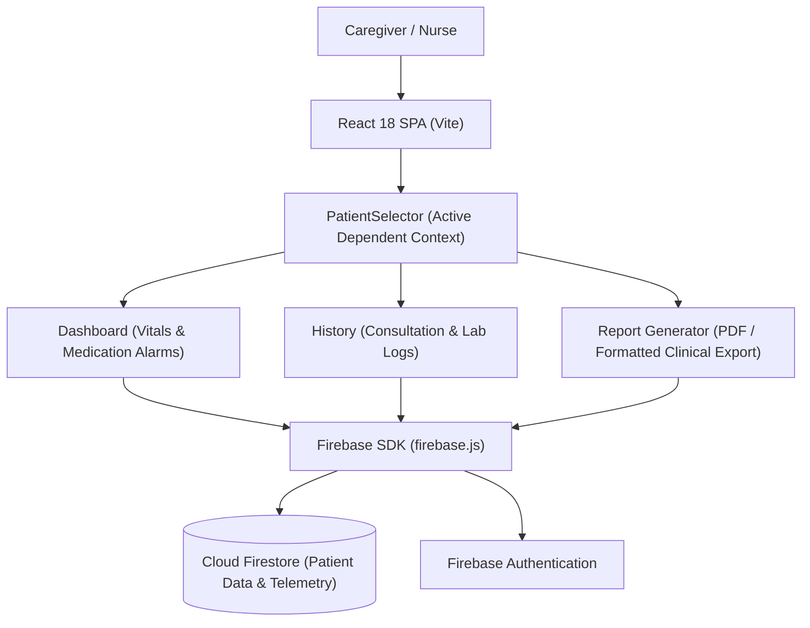

# 🏥 MediMinds — AI Caregiver Support & Patient Health Monitoring

[](https://react.dev/)
[](https://firebase.google.com/)
[](https://vitejs.dev/)
[](https://github.com/karnam-ui/mediminds)

**MediMinds** is a specialized clinical health management portal engineered to assist family caregivers and assisted living nurses in monitoring elderly patients, tracking chronic illness vitals, deciphering medical prescriptions, and generating automated physician summary reports.

---

## 🌟 Core Capabilities

- **Patient Portfolio & Switcher (`PatientSelector.jsx`)**: Seamlessly transition between multiple dependents or elderly family members with isolated medical records.
- **Biometric Vitals Tracking (`dashboard.jsx`)**: Real-time logging of blood pressure, blood glucose, heart rate, and SpO2 levels with visual threshold alerts.
- **Prescription Analysis & OCR**: Transforms handwritten or printed prescription photos into standardized medication schedules.
- **Longitudinal Medical History (`history.jsx`)**: Chronological audit of doctor visits, prescription modifications, and lab test biomarkers.
- **Automated Summary Reporting (`Report.jsx`)**: Generates structured, exportable clinical summaries formatted specifically for physician review during routine consultations.
- **Cloud Synchronization (`firebase.js`)**: Real-time cloud persistence and multi-device synchronization via Firebase Firestore and Authentication.

---

## 🏛️ Application Architecture



---

## 📁 Repository Structure

```
├── PatientSelector.jsx    # Dependent selection drawer and active patient context
├── dashboard.jsx          # Live vitals charts, status cards, and reminder widgets
├── history.jsx            # Chronological consultation logs and past medical events
├── Report.jsx             # Physician summary generator and export module
├── firebase.js            # Firebase SDK configuration and Firestore clients
├── App.jsx                # Layout orchestration and navigation shell
├── App.css                # Component styling and layout classes
├── index.css              # Global styles, color tokens, and responsive resets
├── eslint.config.js       # Linting standards
└── README.md
```

---

## 🚀 Getting Started

### Prerequisites
- Node.js (v18+)
- A Firebase project with Firestore and Authentication enabled

### 1. Installation
```bash
git clone https://github.com/karnam-ui/mediminds.git
cd mediminds
npm install
```

### 2. Configure Firebase
Update `firebase.js` with your Firebase web configuration:
```javascript
const firebaseConfig = {
  apiKey: "YOUR_API_KEY",
  authDomain: "YOUR_PROJECT_ID.firebaseapp.com",
  projectId: "YOUR_PROJECT_ID",
  storageBucket: "YOUR_PROJECT_ID.appspot.com",
  messagingSenderId: "YOUR_SENDER_ID",
  appId: "YOUR_APP_ID"
};
```

### 3. Launch Development Server
```bash
npm run dev
```
Open `http://localhost:5173` in your browser.

---

## 📄 License
This project is open-source under the [MIT License](LICENSE).
